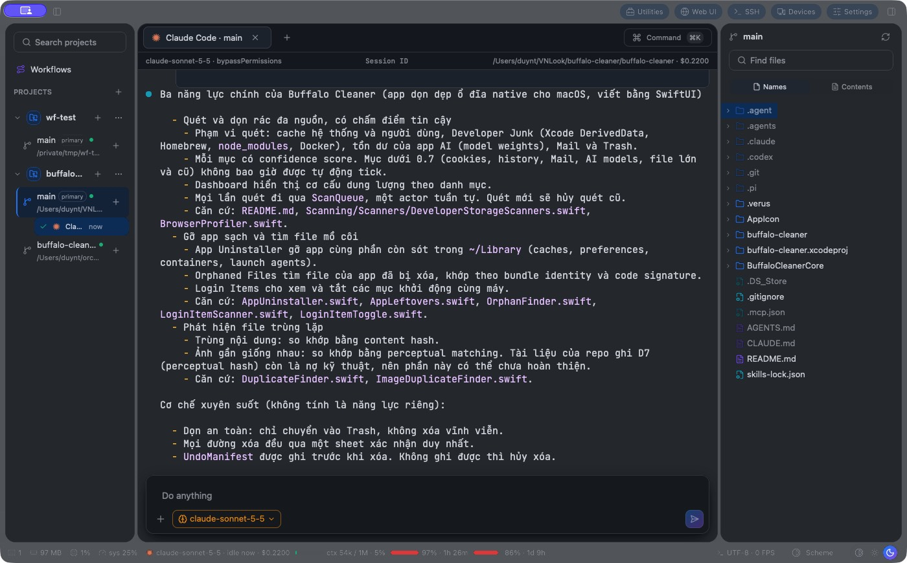
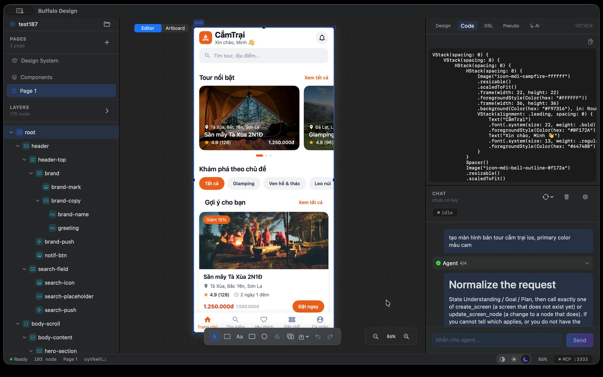
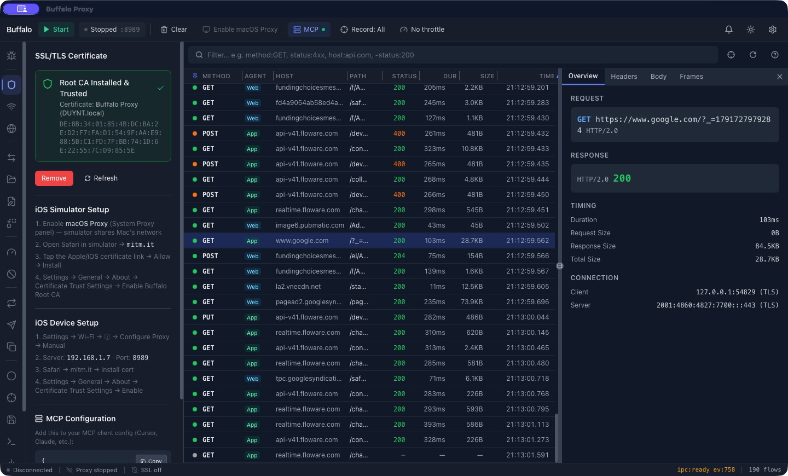
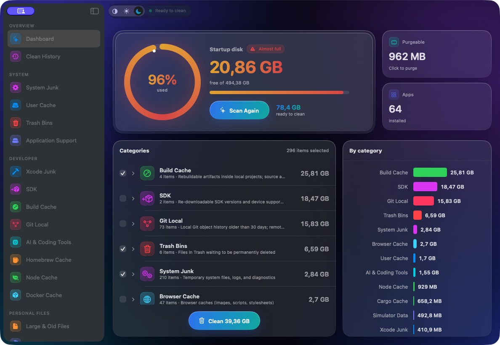

# Buffalo Orbit products

Explore the four products being built by [Buffalo Orbit](https://buffaloorbit.com/en). These public overviews show real app captures, product illustrations, and walkthrough videos. The application source repositories remain private.

| Product | What it helps you do | Overview |
| --- | --- | --- |
|  **Buffalo Agents** | Coordinate projects, worktrees, coding agents, tasks, and device testing. | [Explore Buffalo Agents](buffalo-agents/README.md) |
|  **Buffalo Design** | Shape editable screens with layers, design tokens, and agent tools. | [Explore Buffalo Design](buffalo-design/README.md) |
|  **Buffalo Proxy** | Inspect HTTP/HTTPS traffic and apply breakpoints or traffic rules. | [Explore Buffalo Proxy](buffalo-proxy/README.md) |
|  **Buffalo Cleaner** | Review disk usage and cleanup candidates before cleaning. | [Explore Buffalo Cleaner](buffalo-cleaner/README.md) |

## See the products

| Buffalo Agents | Buffalo Design |
| --- | --- |
|  |  |

| Buffalo Proxy | Buffalo Cleaner |
| --- | --- |
|  |  |

Watch the [Agents](buffalo-agents/README.md#watch-it-in-action) and [Design](buffalo-design/README.md#watch-it-in-action) walkthroughs, or visit the [English website](https://buffaloorbit.com/en) for the full product showcase. Product screenshots and edited feature clips come from the Buffalo Orbit landing page; longer recordings were supplied by the product team.
