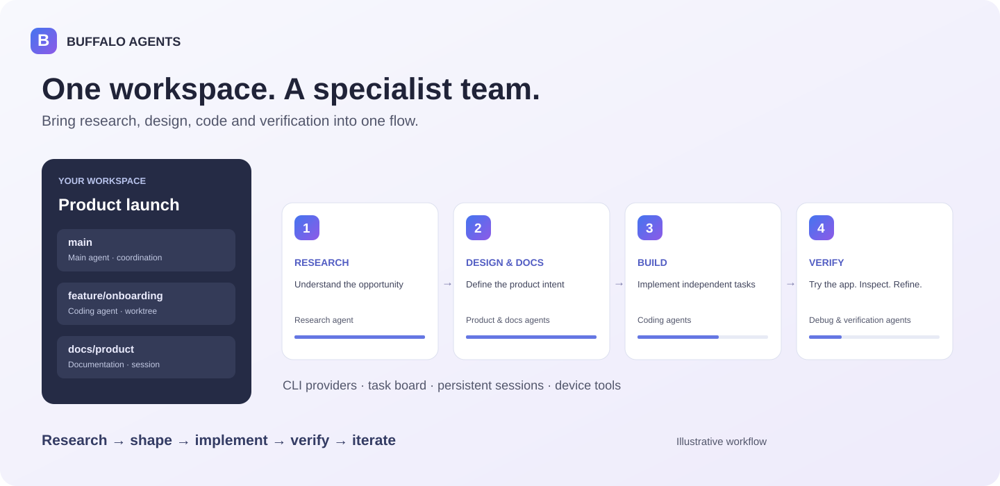
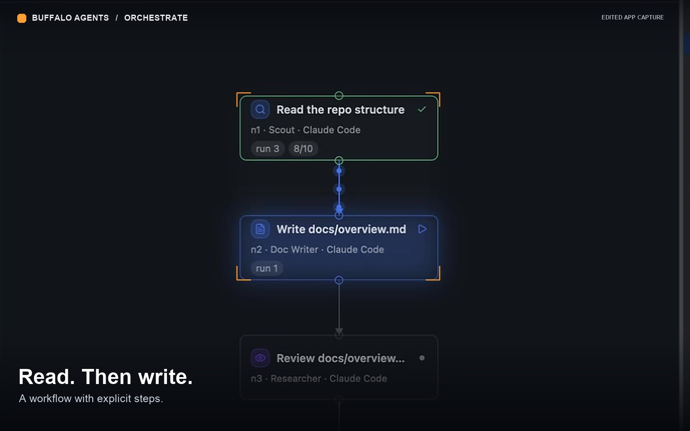
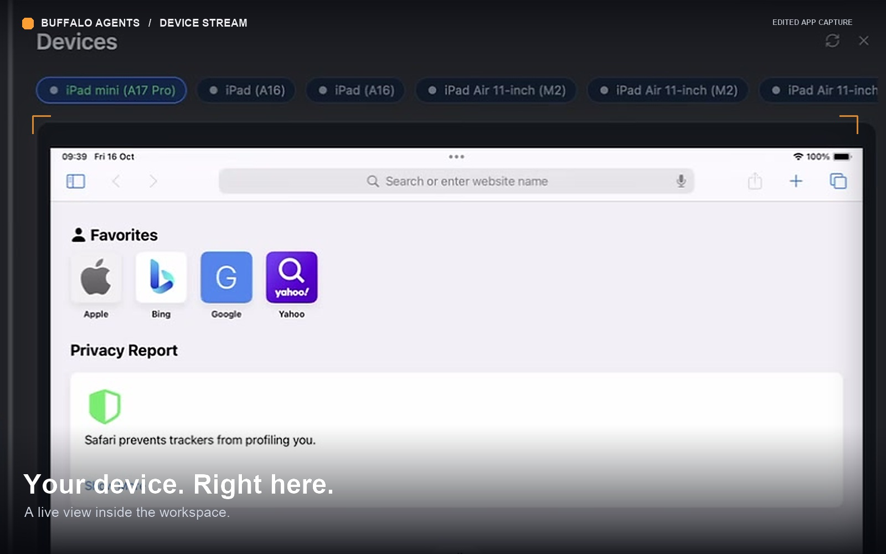
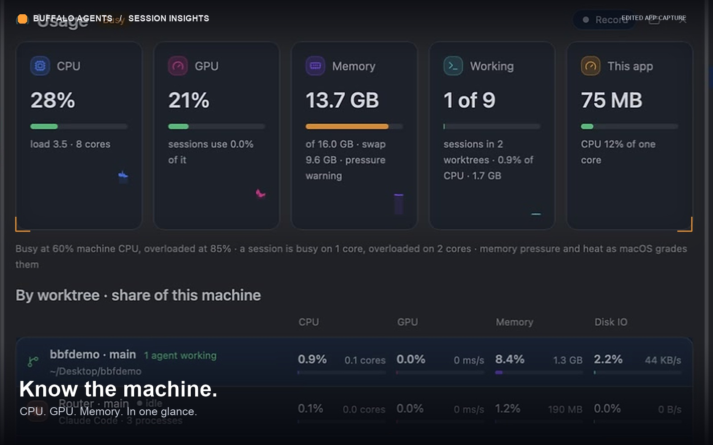
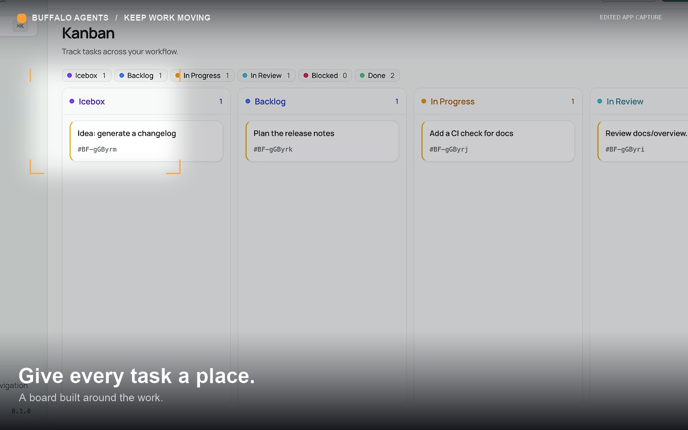
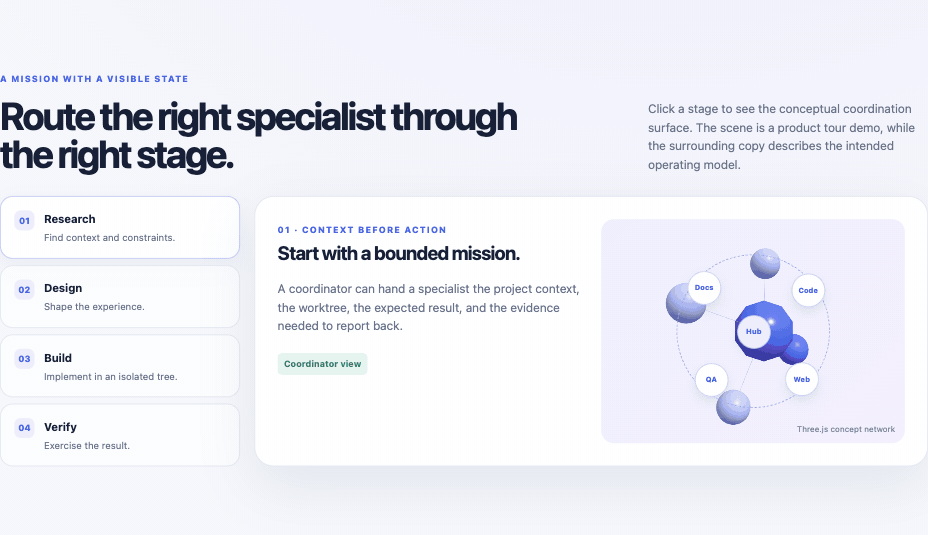

# Buffalo Agents

### Your workspace. Your agents. One coordinated team.

Create and coordinate specialist AI agents across projects, Git worktrees, and persistent sessions — from research and documentation to coding, testing, and debugging.

**Native macOS app · CLI agent teams · Parallel worktrees · App & simulator control**

[Explore the features](#what-you-can-do) · [Meet Buffalo Design](../buffalo-design/README.md) · [Watch demos](#watch-it-in-action) · [Buffalo Orbit website](https://buffaloorbit.com/en#product-agents)

*Product illustration; not an application screenshot.*

*Capture from the running macOS app.*

## Turn a task into a team effort

A product needs more than generated code. It needs research, decisions, clear requirements, documentation, implementation, and testing against real behavior.

Buffalo Agents gives that work a home. Create agent sessions backed by tools such as **Claude Code CLI and Codex**, configure specialist roles, distribute tasks, and follow the results in one workspace. Keep independent changes in separate Git worktrees and return to conversations without losing their context.

You choose the providers, tools, and responsibilities. Buffalo Agents organizes how the team works together.

## What you can do

### Assemble your agent team

- Choose from Claude Code, Codex, Cursor, Grok, Command Code, and Oh My Pi.
- Configure a main agent and specialist roles for different kinds of work.
- Use Claude, Codex, or Mixed team profiles and customize role assignments.
- Coordinate dependent work through Dynamic Workflows and review each stage's output.

### Keep projects and conversations organized

- Manage multiple projects and workspaces in one window.
- Create Git worktrees for independent changes and keep their sessions together.
- Work across agent conversations, terminals, an editor, and document previews.
- Queue follow-up messages and reconnect to background sessions after reopening the app.

### Work beyond coding

Use specialist agents for **market and competitor research, product analysis, specifications, documentation, implementation, or code review**. These are assignments for your configured agents; their research abilities depend on the provider, tools, and access you give them.

Keep requirements, plans, tasks, process steps, and verification notes alongside the work. Use the task board and local Web UI to see what is happening and what comes next.

### Debug the app people actually use

- Give agents tools to inspect and interact with supported iOS simulators, macOS apps, Android devices, and browsers.
- Reproduce actions, read interface state, and capture visual evidence where supported.
- Bring runtime logs into the investigation, then verify a fix against the original behavior.
- Use SSH sessions to work with remote environments and an agent assistant.

Device access, permissions, and setup vary by platform.

### Carry your working conventions with you

Sync skills, agent definitions, rules, hooks, and tool configuration into worktrees through Buffalo Harness. Manage credentials with macOS Keychain and inspect resource usage as your team runs.

## Better together with Buffalo Design

[**Buffalo Design**](../buffalo-design/README.md) is the companion product for shaping an app's interface and intended experience. **Buffalo Agents** coordinates the work that turns that intent into a working product.

| Stage | How the products complement each other |
| --- | --- |
| Understand | Assign agents to research the market, clarify the problem, and write requirements. |
| Shape | Explore wireframes and detailed screens in Buffalo Design; define the intended interactions. |
| Build | Give specialist agents the design context, assets, and behavior requirements; implement in separate worktrees. |
| Verify | Use agent-controlled simulators, apps, or browsers to compare the result with the intended experience. |
| Iterate | Bring findings back into the design and the next development tasks. |

This is the intended combined workflow. Handoffs use available design tools, assets, and documentation; a complete automatic design-to-production pipeline is still a product goal.

## Watch it in action

[Watch the edited product reel](https://buffaloorbit.com/products/motion/agents-reel.mp4). Feature clips from the [Buffalo Orbit website](https://buffaloorbit.com/en):

| Workflow | Devices | Session usage | Kanban board |
| --- | --- | --- | --- |
|  |  |  |  |

Longer product recordings supplied by the team:

- [Agent workflow from start to finish](media/videos/workflow-full.mp4)
- [Workflow tree](media/videos/workflow-tree.mp4) and [completion](media/videos/workflow-complete.mp4)
- [SSH session](media/videos/ssh-session.mp4)
- [Resource usage by session](media/videos/session-usage.mp4)
- [Web task board](media/videos/web-board.mp4)

*The animation above is a concept illustration, separate from the app recordings.*

## Status and access

Buffalo Agents is under active development for **macOS**. CLI-backed sessions, worktree organization, agent coordination, task/document tools, and device tooling are implemented. Availability depends on provider authentication and platform setup. The complete autonomous research-to-release workflow remains a direction for the product.

The source repository and detailed setup documentation are private. This public overview is for evaluating the product direction; collaborators with repository access can build the current app from source.
