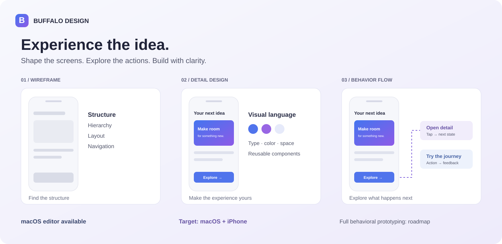
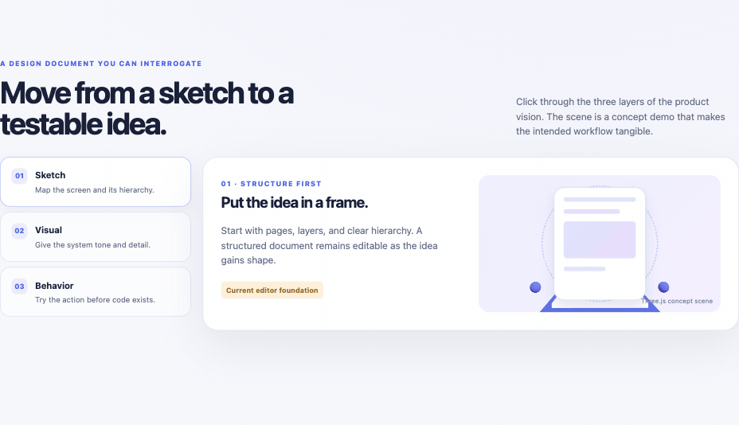

# Buffalo Design

### Design the app. Experience it before you build it.

A design and prototyping app for turning ideas into wireframes, detailed interfaces, and interactive experiences — so people can explore how an app should look, feel, and behave before development begins.

**Wireframes · Detailed design · Prototypes · Behavior flows**

**Built for macOS today. Targeting macOS and iPhone.**

[Explore the vision](#from-an-idea-to-an-experience) · [Meet Buffalo Agents](../buffalo-agents/README.md) · [Concept preview](#concept-preview)

*Product illustration; not an application screenshot.*

## From an idea to an experience

A screen tells you what an app looks like. A prototype lets you discover what using it should feel like.

Buffalo Design is being built to support that whole journey: explore a layout, refine the visual design, connect screens and actions, and try the experience before committing to implementation. The goal is a shared space where designers, product teams, developers, and AI agents can shape an app together.

The current app provides a **macOS design editor** with structured documents, design-system tools, imports, and agent-assisted editing. **An iPhone app and complete behavior-flow prototyping are product targets**, not capabilities claimed as released today.

## The experience we are building toward

| From | To | What you can decide earlier |
| --- | --- | --- |
| An idea | Wireframes | Screen structure, information hierarchy, and the main journey. |
| Wireframes | Detailed design | Layout, typography, color, reusable components, and visual states. |
| Separate screens | Connected prototypes | Navigation, actions, transitions, and what happens next. |
| A prototype | An app-like experience | Whether the interaction makes sense when someone actually tries it. |
| A validated experience | Development context | What to build, how it should behave, and what needs verification. |

The target is to let people **tap, navigate, trigger actions, and explore state changes as if they were using the future app**, across macOS and iPhone. Full interaction authoring and playback are part of this direction.

## What you can use today

### Shape screens on a structured canvas

Work with pages, layers, frames, text, and shapes. Refine layout and appearance in the inspector, preview artboards, and use undo/redo as the design evolves. Screens remain editable documents that you and an agent can continue working on.

### Build a consistent visual language

Manage workspace colors, typography, spacing, radius, and other design tokens. Reuse components and keep the product's visual decisions together as screens grow.

### Start from references and existing artwork

Import SVG and raster images, bring in icons and project assets, and use SVG/PNG wizard flows to create editable screen structures while keeping the original reference available for comparison.

### Design with AI assistance

Describe the screen you want, review the agent's changes on the canvas, and refine the result. The app includes provider-backed chat and design tools available through MCP for external agents.

### Prepare for implementation

View generated SwiftUI and structured UI descriptions, and export visual assets through supported design tools. These outputs help communicate implementation intent; they still need engineering review and testing.

## Better together with Buffalo Agents

[**Buffalo Agents**](../buffalo-agents/README.md) creates and coordinates specialist AI agent sessions — including Claude Code CLI and Codex — across workspaces, Git worktrees, and conversations.

Use the two products as complementary parts of the journey:

1. **Research the opportunity.** Assign agents to market research, product analysis, and requirements.
2. **Shape the experience.** Use Buffalo Design for wireframes and detailed screens; define the intended actions and behavior flows.
3. **Coordinate the build.** Give implementation agents the design context, assets, and requirements, with separate worktrees for independent tasks.
4. **Test the result.** Use Buffalo Agents' simulator, macOS app, or browser tools to inspect the implemented behavior and investigate defects.
5. **Refine together.** Turn testing feedback into design changes and the next round of development work.

This describes the intended combined workflow. Available tools support design handoffs and app inspection; a fully automatic design-to-production loop is still a product goal.

## Concept preview

*Animated concept preview; it does not run the native app or prove that the roadmap is implemented.*

## Status and access

The current app is a **macOS design editor**. An iPhone app and complete behavior-flow prototyping remain product goals. The source repository and build instructions are private; collaborators with repository access can build the current app from source.
