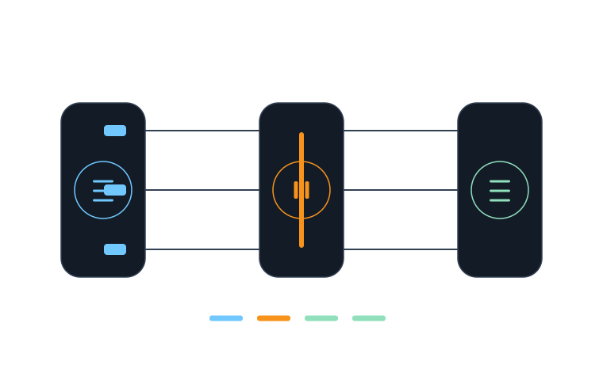

# Buffalo Proxy

### Pause the request. Understand the flow.

A macOS app for observing HTTP/HTTPS traffic in a native interface. Inspect requests and responses, pause a request at a breakpoint, and apply mapping or rewrite rules in context.

[Explore Buffalo Orbit](https://buffaloorbit.com/en#product-proxy) · [All four products](../README.md)

*Capture from the running app. The selected request's status, timing, and connection details are visible beside the traffic list.*

## What you can do

- **Capture traffic:** observe HTTP/HTTPS requests and responses from apps and devices.
- **Inspect a flow:** read method, host, path, status, headers, body, and timing details.
- **Pause and shape traffic:** use breakpoints, mapping, and rewrite rules while debugging an integration.
- **Work with an agent:** MCP tools let configured agents inspect and control the proxy.

*Workflow illustration; the image above is separate from the app capture.*

## Status and access

Buffalo Proxy is a macOS developer tool under active development. The screenshot above shows a running build. The application source repository and build instructions remain private; this page is the public product overview.

See the [Buffalo Orbit website](https://buffaloorbit.com/en#product-proxy) for the full showcase.
